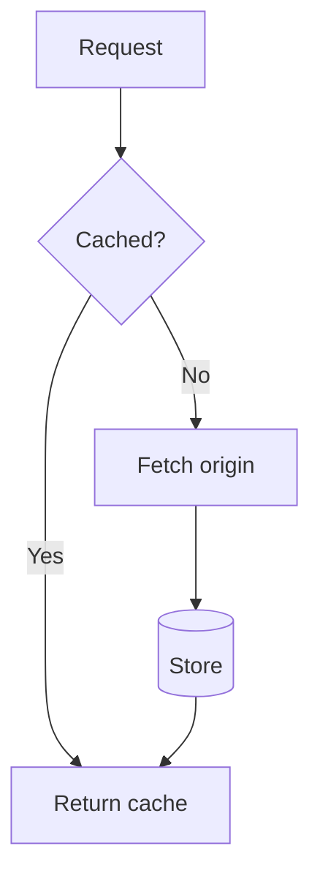
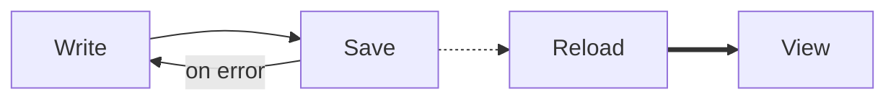
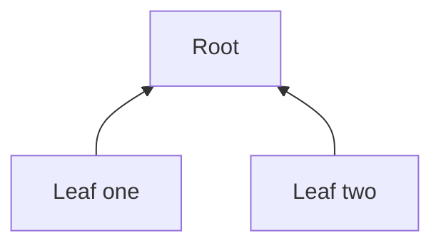
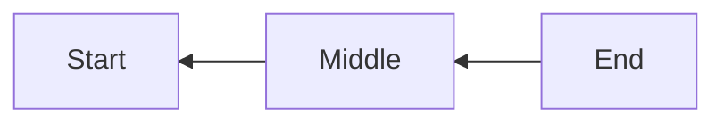
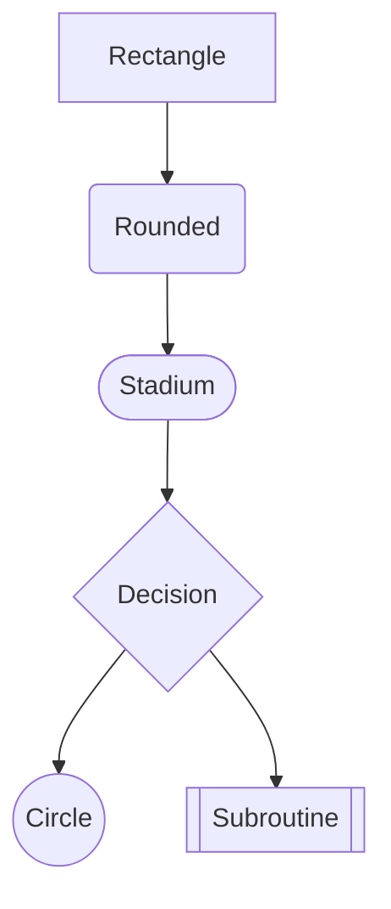
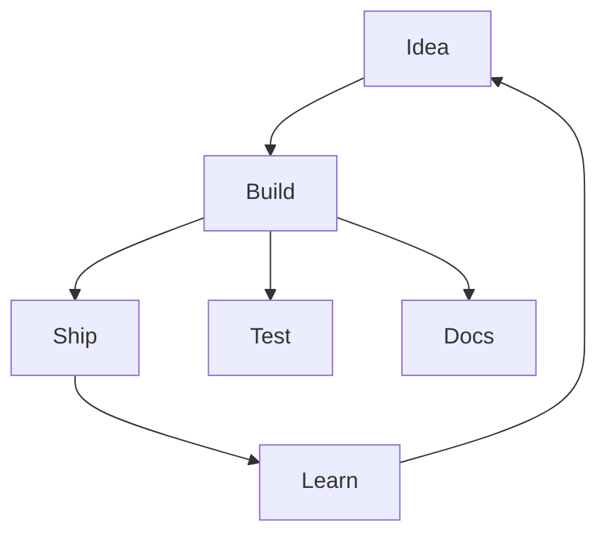
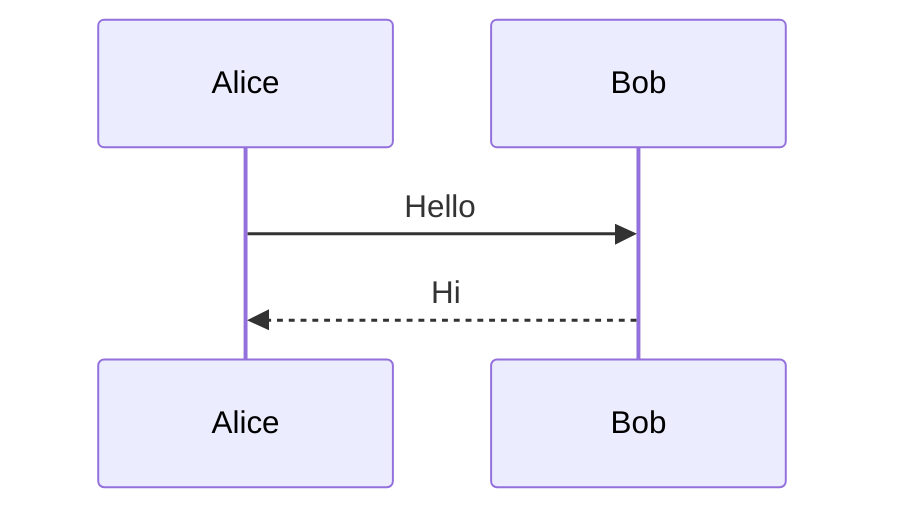

# Diagrams

Mermaid `graph` and `flowchart` blocks are drawn with box characters.

## Top down

## Left to right

## Bottom up

## Right to left

## Node shapes

## Cycles and fan out

## Unsupported diagram

Sequence diagrams are shown as plain code:

