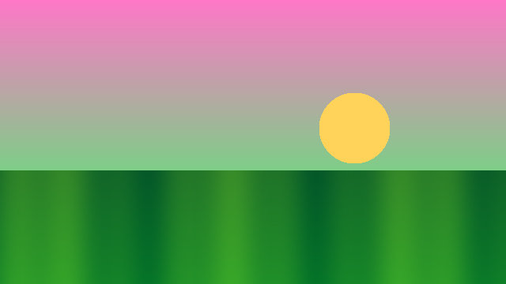

# Images

In Kitty, Ghostty, iTerm2 or WezTerm you see real images. Other terminals, and tmux, get colored half blocks. Images only draw at full resolution when they fit on screen, so scroll until each one is fully visible.

## PNG gradient

## JPEG photo-like scene

## Transparent PNG

The corners are transparent and should show the background. Toggle `t` to see it on both themes.

## Checkerboard

Sharp edges show the sampling quality of the half-block fallback.

## Tall image

Capped in height so it does not take over the screen.

## Wide image

Scaled down to the content width.

## Remote image

Fetched over HTTPS in the background, shown as "loading" first.

## HTML image tag

## Linked image

## Inline image in text

Text before  and after shows a placeholder link instead.

## Broken image

