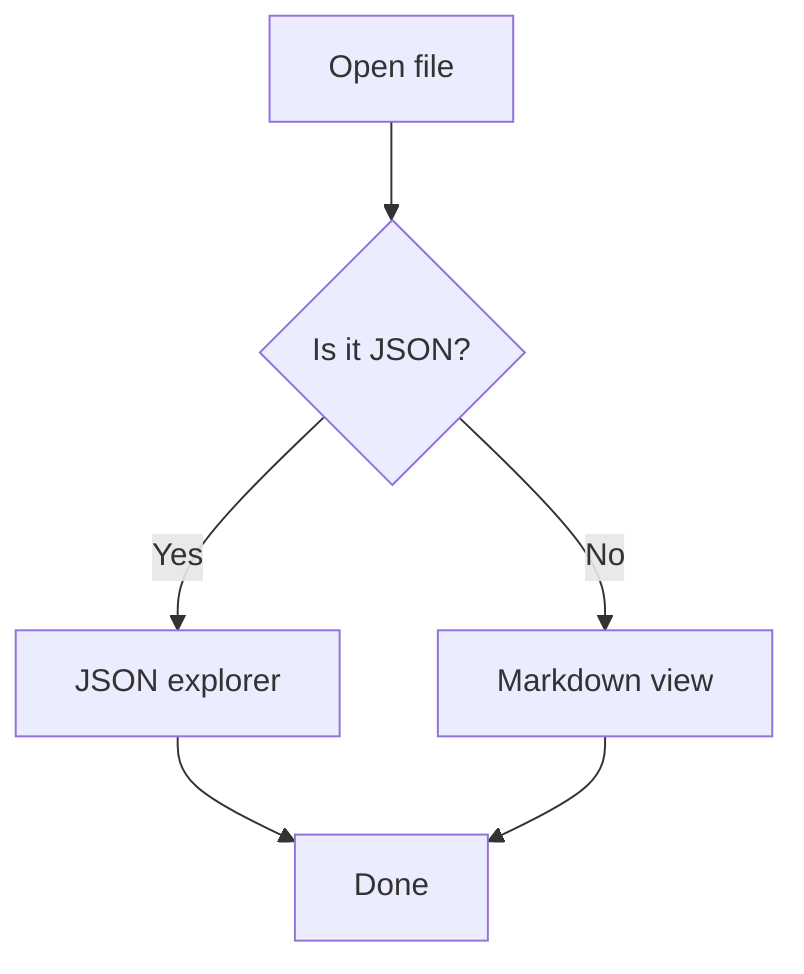
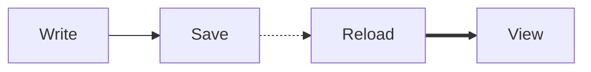

# mdt Showcase

Everything mdt renders, in one file. Open it with `mdt test/fixture.md` and press `?` for the keys.

## Text

Plain, **bold**, *italic*, ~~struck~~ and `inline code`. Mixed: ***bold italic***, **~~bold struck~~**.

Escaped \*asterisks\*, an entity &copy; and a hard<br>break.

## Headings

### Third level

#### Fourth level

##### Fifth level

###### Sixth level

## Links

An external [Node.js](https://nodejs.org) link, an anchor to [Math](#math) and a local [linked file](linked.md).

A [missing file](missing.md) shows a "Not found" message.

## Images


## Math

Inline: $E = mc^2$, $\alpha + \beta = \gamma$ and $x \in \mathbb{R}$.

$$
x = \frac{-b \pm \sqrt{b^2 - 4ac}}{2a}
$$

$$
\sum_{k=1}^{n} k = \frac{n(n+1)}{2}
$$

## Code

```typescript
type Point = { x: number; y: number };

export function distance(a: Point, b: Point): number {
  return Math.hypot(a.x - b.x, a.y - b.y);
}
```

```python
def fizzbuzz(n: int) -> str:
    if n % 15 == 0:
        return "FizzBuzz"
    return "Fizz" if n % 3 == 0 else "Buzz" if n % 5 == 0 else str(n)
```

```bash
curl -s https://example.com/README.md | mdt
```

## Diagram





## Lists

- Apples
- Oranges
  - Blood orange
  - Navel
    - Seedless
- Pears

1. Install
2. Build
   1. Typecheck
   2. Compile
3. Run

## Tasks

- [x] Render Markdown
- [x] Toggle a checkbox by clicking it
- [ ] Click me to check this one

## Quotes

> Simple things should be simple.

> [!NOTE]
> Alerts get a colored bar and a title.

> [!WARNING]
> Clicking a checkbox writes to the file.

## Tables

| Key | Action | Notes |
|:----|:------:|------:|
| `/` | Search | Regex works |
| `o` | Contents | Jump to a heading |
| `f` | Links | Type a number |
| `t` | Theme | Dark or light |

## Rules

Above the rule.

---

Between rules. In `--slides` mode each `---` starts a new slide.

---

Below the rule.

## Long text

Lorem ipsum dolor sit amet, consectetur adipiscing elit. Sed do eiusmod tempor incididunt ut labore et dolore magna aliqua. Ut enim ad minim veniam, quis nostrud exercitation ullamco laboris nisi ut aliquip ex ea commodo consequat.

Duis aute irure dolor in reprehenderit in voluptate velit esse cillum dolore eu fugiat nulla pariatur. Excepteur sint occaecat cupidatat non proident, sunt in culpa qui officia deserunt mollit anim id est laborum.

## End

Press `g` to go back to the top.
